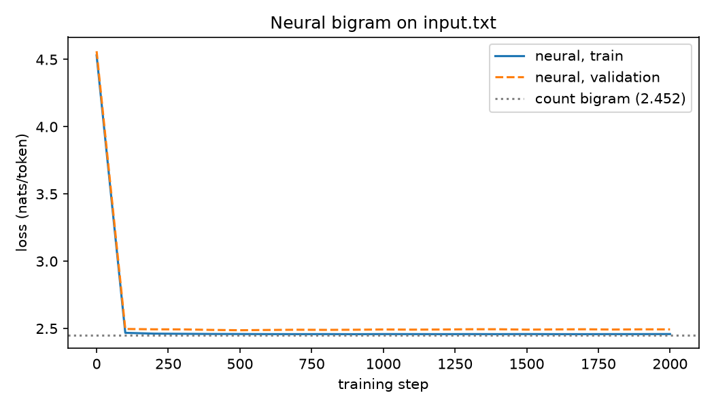

# Next-Token Prediction from Scratch

An LLM generates text by predicting the next token, over and over.

This folder builds that idea twice, as small as I could make it:

1. `bigram.py`: count which character follows which. No ML library.
2. `neural.py`: the same model in PyTorch, learned by training instead of counting.

Both models look at only one character to guess the next one, so the output is gibberish.
It also keeps the code short.

## The idea in four steps

Take this text: `the cat sat on the mat`

1. Count what follows each character. After `t` comes `h` twice and a space twice. After `a`
   comes `t` three times.
2. Turn the counts into probabilities. After `t`: 50% `h`, 50% space. After `a`: 100% `t`.
3. Generate text. Start with a character, roll weighted dice for the next one, and repeat.
4. Score the model. Loss measures how surprised the model is by the real text. Lower is better.

`bigram.py` does exactly these four steps. `neural.py` gets to the same probabilities by
training: it starts with random numbers and adjusts them a little on every step to lower the loss.

## Run

```bash
# small example you can check by hand
uv run python next-token-from-scratch/bigram.py data/tiny.txt
uv run --group neural python next-token-from-scratch/neural.py data/tiny.txt

# full Shakespeare text (download it first, see Data)
uv run python next-token-from-scratch/bigram.py
uv run --group neural python next-token-from-scratch/neural.py
```

## Data

`data/tiny.txt` is included. It is one sentence, small enough to check every number by hand.

For the full run, download tiny Shakespeare (1.1 MB) to `data/input.txt`:

```bash
curl -fL -o next-token-from-scratch/data/input.txt \
  https://raw.githubusercontent.com/karpathy/char-rnn/master/data/tinyshakespeare/input.txt
```

## Results

Loss in nats per character. Lower is better.

| Text | Blind guess | Bigram counts | Neural |
|------|-------------|---------------|--------|
| `tiny.txt` (22 characters) | 2.30 | 0.515 | 0.522 |
| Shakespeare (1.1M characters) | 4.17 | 2.45 | 2.46 |

Counting and training end up at almost the same loss. That is expected, because both models
see the same one character of context.

Sample from the bigram model on Shakespeare:

```
HOHor ys!
Ththes bor be bere? t mo.
IARKIINGLAs me yowe. ncrunde love;
```

The output looks like a play (names in capitals, colons, line breaks) but has no real words.
One character of context is not enough for that.

Loss curve for `neural.py` on Shakespeare. The dotted line is the counting model:



## What I learned

- Text generation is a loop: get probabilities for the next token, pick one, add it, repeat.
- Training adjusts the model's numbers a little at a time to lower the loss.
- For a model this small, counting gives the exact answer and training ends up close to it.
- This is far from a Transformer or GPT, but those use the same loop and the same loss with
  a much bigger model.
